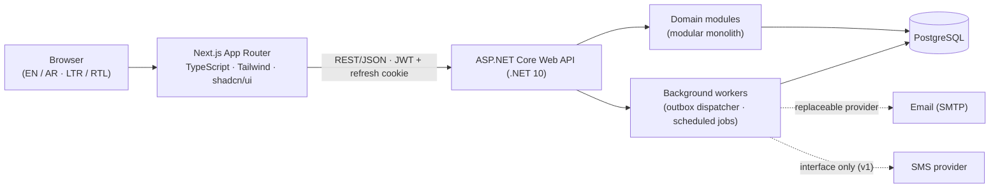
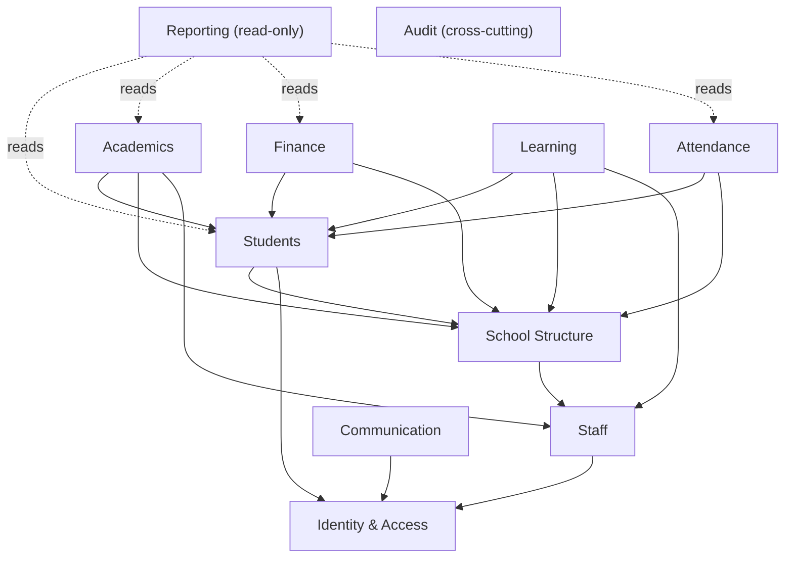

# SchoolOS — Architecture

> **Status:** Phase 1 deliverable (draft v1, 2026-10-12).
> **Companion docs:** `requirements.md`, `erd.md`, `database-design.md`, `security-plan.md`, `implementation-plan.md`.

---

## 1. Overview

SchoolOS is a **modular monolith**: one ASP.NET Core Web API deployable, one Next.js frontend, one PostgreSQL database. Modules have explicit boundaries and ownership; they communicate through application-layer contracts, not by reaching into each other's tables. No microservices (premature for this scope), no generic repositories, no abstractions without a present need.



## 2. Backend layering

| Project | Contains | May depend on |
|---|---|---|
| `SchoolOS.Domain` | Entities, enums, value objects, domain rules, domain events. No infrastructure references. | — |
| `SchoolOS.Application` | Use-case handlers (commands/queries), DTOs, validators (FluentValidation), module contracts (interfaces + DTOs), authorization scope abstractions. | Domain |
| `SchoolOS.Infrastructure` | EF Core `DbContext` + migrations, query services, outbox dispatcher, adapters (email, file storage, clock), audit interceptor. | Application, Domain |
| `SchoolOS.Api` | Controllers, middleware, auth wiring, OpenAPI, rate limiting, composition root. | Application, Infrastructure |
| `SchoolOS.Tests` | Unit + integration tests (`WebApplicationFactory` + Testcontainers PostgreSQL). | all |

Rules:

- Dependencies point **inward** (Api → Infrastructure → Application → Domain). Domain references nothing.
- Controllers are thin: bind → validate → dispatch → map result to HTTP. **No business logic in controllers.**
- API never serializes entities; only explicit DTOs cross the boundary.
- Architecture tests (NetArchTest) enforce module dependency rules in CI.

## 3. Modules (boundaries & ownership)

Each module owns its tables, its domain rules, and its application handlers. Cross-module data access happens via contract interfaces + IDs, or through the read side for reporting.



| Module | Owns (tables) | Depends on | Notes |
|---|---|---|---|
| Identity & Access | `identity`: User, Role, UserRole, Permission, RolePermission, RefreshToken | — | ASP.NET Core Identity as the credential store; permission catalog in DB. |
| School Structure | `structure`: School, AcademicYear, AcademicTerm, GradeLevel, ClassSection, Subject, Classroom, TeacherAssignment, TimetableSlot | Staff (staff IDs), Identity (user IDs) | Sections are scoped to an academic year. Timetable conflict rules live here. |
| Students | `students`: Student, AdmissionApplication, Guardian, StudentGuardian, Enrollment, StudentDocument | Structure, Identity | Enrollment history is append-only. |
| Staff | `staff`: StaffMember | Identity | Workload computed from Structure. |
| Attendance | `attendance`: AttendanceSession, AttendanceRecord | Students, Structure | Duplicate prevention at DB level. |
| Academics | `academics`: GradingPolicy, Assessment, AssessmentComponent, Grade, GradeChange, TermSubjectResult, ReportCard | Students, Structure, Staff | Publication snapshots are immutable. |
| Finance | `finance`: FeeStructure, StudentInvoice, InvoiceLine, Installment, DiscountGrant, Payment, PaymentAllocation, Refund | Students, Structure | Ledger-style immutability; transactional ops. |
| Learning | `learning`: Homework, HomeworkAttachment, Submission, SubmissionAttachment, LearningResource | Students, Structure, Staff | Submissions unique per (homework, student). |
| Communication | `communication`: Announcement, AnnouncementTarget, Notification, NotificationPreference, OutboxMessage | Identity | Outbox dispatcher sends emails/SMS. |
| Reporting | — (no owned tables) | read-only across modules | Query services + DTOs; no cross-module writes. |
| Audit | `audit`: AuditLog | all (as writer via events/interceptor) | Append-only; never contains secrets. |

Boundary rules:

- **No circular dependencies.** The graph above is enforced by review + architecture tests.
- Cross-module references use IDs and contract interfaces (e.g., Attendance asks Students `IStudentLookup` for section rosters).
- One EF Core `DbContext` with per-module **PostgreSQL schemas** (`identity`, `structure`, `students`, …) — ownership stays visible at the database level.

## 4. Cross-cutting concerns

| Concern | Approach |
|---|---|
| Use-case dispatch | MediatR (in-process). Commands and queries are explicit types; pipeline behaviors for validation, logging, transactions. CQRS used **where it earns its keep** (write models simple; dedicated read/query services for reporting and portals) — no event sourcing, no per-module buses. |
| Validation | FluentValidation validators executed in the MediatR pipeline + model binding; business rules also guarded in domain layer; DB constraints as the final backstop. |
| Mapping | Mapster for straightforward DTO mapping; hand-written mapping for security-sensitive or computed shapes. Never expose entities. |
| Error contract | `ProblemDetails` (RFC 9457) + stable machine-readable `code` per error; validation errors aggregated; no stack traces to clients. |
| Pagination / filter / sort | Conventions: `?page=&pageSize=&sort=&<filters>`; response envelope `{ items, page, pageSize, total }`; keyset pagination for high-volume lists (attendance, audit, notifications). |
| Async & cancellation | All handlers/EF calls async; `CancellationToken` flowed from request. |
| Transactions | Explicit transactions for multi-write operations (enrollment changes, publication batches, invoice generation, payment posting, refunds, year rollover). Outbox row written in the **same transaction** as the business change. |
| Concurrency | Optimistic concurrency via PostgreSQL `xmin` token on editable aggregates; conflicts → HTTP 409 with guidance. |
| Auditing | SaveChanges interceptor records flagged business changes; explicit audit events for approvals, financial ops, security events. Append-only AuditLog (see `security-plan.md` for content rules). |
| Logging | Serilog structured logs; correlation ID middleware; sensitive fields redacted; request latency logging. |
| API docs | OpenAPI document from the API project (built-in `Microsoft.AspNetCore.OpenApi`); interactive UI enabled in dev. |
| Rate limiting | ASP.NET Core rate limiter; policies for login, password reset, uploads, public endpoints. |
| Health & ops | `/health/live`, `/health/ready`; configuration strictly environment-based. |

## 5. Authentication & authorization (summary — details in `security-plan.md`)

- **Credential store:** ASP.NET Core Identity (users; role catalog mirrored in DB for admin management).
- **Tokens:** short-lived JWT access token (≈15 min, in memory on the client) + rotating refresh token (hashed at rest, delivered as httpOnly, Secure, SameSite cookie; reuse detection revokes the family). Logout revokes the refresh token; password change/reset revokes all sessions.
- **Authorization:** permission codes (e.g. `students.view`, `grades.approve`, `finance.payments.post`) grouped into roles; policies on endpoints; **resource-based handlers** for the hard cases:
  - parent ↔ child: every portal query resolves the authenticated guardian and verifies an active `StudentGuardian` link for the target student;
  - teacher ↔ section: teachers act only on sections/subjects they are assigned to.
- UI reflects permissions for affordance only — **the server is the security boundary**.

## 6. Background processing

- **Transactional outbox** (`communication.OutboxMessage`): emails, notifications, and side effects are enqueued in the same transaction as the business write. A `BackgroundService` dispatcher polls with `FOR UPDATE SKIP LOCKED`, sends via `IEmailSender`/`ISmsSender` (replaceable), retries with exponential backoff, and marks dead-letter after N attempts.
- **Scheduled jobs:** lightweight in-process scheduler (`ScheduledJobsHostedService` + job registry) for recurring-absence scans, overdue-invoice reminders, expired-token cleanup, and year-close helpers. (If operational needs grow — job UI, clusters — Hangfire/Quartz can replace it; documented alternative.)
- Guarantee: **core academic/financial transactions never depend on an external notification service being up.**

## 7. Data access

- EF Core + Npgsql; one `DbContext`; per-module schemas; migrations managed with `dotnet ef` (local tool) and applied via a migration bundle in deployments.
- Naming: snake_case tables/columns via `EFCore.NamingConventions`; module prefix implicit in schema name.
- Query guidelines: `AsNoTracking` reads; project directly to DTOs; limit `Include`; no unbounded collections; explicit indexes per `database-design.md`; keyset pagination where volume demands.
- FK delete behaviors: `RESTRICT`/no-action by default; no cascading deletes on core data (see `database-design.md`).
- Time: UTC (`timestamptz`) for instants; plain `date` for school-local calendar dates (attendance, due dates) interpreted in the school timezone.

## 8. Frontend architecture

- **Next.js (App Router) + TypeScript (strict) + Tailwind CSS + shadcn/ui.** React Hook Form + Zod for all forms.
- **Server state** with TanStack Query (caching, retries, invalidation); a typed API client wraps `fetch`, attaches the access token, and performs silent refresh on 401 (single-flight).
- Routing structure mirrors modules:

```
app/(auth)/login, reset-password
app/(app)/dashboard            → role-aware redirect
app/(app)/structure|students|staff|attendance|academics|finance|learning|communication|reports|admin
app/(portal)/parent/children/[studentId]/...
app/(portal)/student/me/...
```

- **i18n / RTL:** locale segment (`/en`, `/ar`) with message catalogs; `dir="rtl"` for Arabic; logical CSS properties (ms/me, ps/pe) everywhere; Arabic-capable font (e.g. IBM Plex Sans Arabic); `Intl` formatting; printable pages styled for both directions.
- **UX states:** loading skeletons, empty states, error boundaries per route segment; confirmation dialogs for destructive actions; toast feedback; no placeholder buttons in completed features.
- **Accessibility:** keyboard-navigable dialogs/menus, focus management, labels and error messaging wired to fields, contrast-checked tokens.
- **Design system:** single source of truth for typography, spacing, color tokens, and component variants (shadcn/ui base + school-specific composites).
- **Frontend tests:** Vitest + React Testing Library for critical forms/flows; Playwright smoke journeys added in Phase 7.

## 9. Development environment baseline (verified 2026-10-12)

| Component | Verified state | Notes |
|---|---|---|
| OS / shell | Windows 10.0.26200 (x64), PowerShell | Dev machine; app itself is cross-platform. |
| .NET SDK | **10.0.101** at `C:\Program Files\dotnet` | PATH resolves a bundled dotnet host **without SDKs** — scripts must call `C:\Program Files\dotnet\dotnet.exe` (or fix PATH). |
| Node / npm | v22.22.0 / 10.9.4 | Next.js dev/build. |
| Docker | Docker 28.1.1 + Compose v2.35.1 | Start Docker Desktop before dev; PostgreSQL runs as a container. |
| PostgreSQL | none natively installed | Containerized via `docker-compose` service `db`. |
| Git / GitHub | git 2.44.0; credential manager configured | Repo: `D:\ForGitUploads\SchoolManagement` → `github.com/dante127/EduNexa` (public, `main`). CI (GitHub Actions) planned in Phase 2. |

Command conventions (also in `implementation-plan.md`):

```powershell
# Backend
& 'C:\Program Files\dotnet\dotnet.exe' build
& 'C:\Program Files\dotnet\dotnet.exe' test
& 'C:\Program Files\dotnet\dotnet.exe' ef migrations add <Name> --project src/SchoolOS.Infrastructure

# Database (local)
docker compose up -d db

# Frontend
npm run dev --prefix src/web
npm run build --prefix src/web
```

## 10. Decision log (ADR summary)

| # | Decision | Rationale | Notable alternatives rejected |
|---|---|---|---|
| 1 | Modular monolith (4 layers + module partitions, per-module PG schemas) | Right size for scope; boundaries enforceable without distributed complexity | Microservices (premature); unstructured monolith (erodes) |
| 2 | ASP.NET Core Identity + JWT access + rotating refresh cookie | Standard, supports revocation/rotation, SPA-friendly; no custom crypto | Session-cookie-only (harder for API clients), custom auth (risky) |
| 3 | MediatR in-process with selective CQRS | Pipeline behaviors (validation/logging/audit); avoid over-abstraction | Full CQRS everywhere; no mediator (fat services) |
| 4 | Transactional outbox for notifications | Reliability; notifications never block core transactions | Direct send in request; external queue (extra infra) |
| 5 | EF Core + Npgsql, no generic repository | Full EF power (projections, batching); explicit query services | Repository/UoW wrappers (hide EF, add nothing) |
| 6 | UUIDv7 primary keys | Non-enumerable, time-sortable, client-side generation | BIGSERIAL (enumeration, distributed-unfriendly) |
| 7 | Mapster + manual mapping for sensitive paths | Less boilerplate, still explicit where it matters | AutoMapper (config-heavy), hand everywhere (noise) |
| 8 | TanStack Query + typed fetch client | Caching/retry/invalidations with small footprint | SWR; server actions only (auth/refresh interplay harder) |
| 9 | next-intl style locale routing (`/en`, `/ar`) with RTL | Real RTL from day one, printable localization | Client-only i18n (late RTL pain) |
| 10 | xUnit + Testcontainers (PostgreSQL) | Realistic integration tests incl. DB constraints | In-memory provider (misses real SQL behavior) |
| 11 | Optimistic concurrency via `xmin` | Zero-schema-cost versioning on editable rows | Manual `RowVersion` columns (extra bookkeeping) |
| 12 | Report card & term results materialized at publication | Issued documents must be immutable snapshots | Recompute-on-read (history mutates silently) |

## 11. Non-goals guardrails

- No premature abstractions, no "framework" building, no unused interfaces.
- No cross-module table joins outside reporting queries.
- No business logic in controllers; no EF entities on the wire; no raw dynamic SQL.
- No hardcoded secrets; configuration strictly environment-based.
