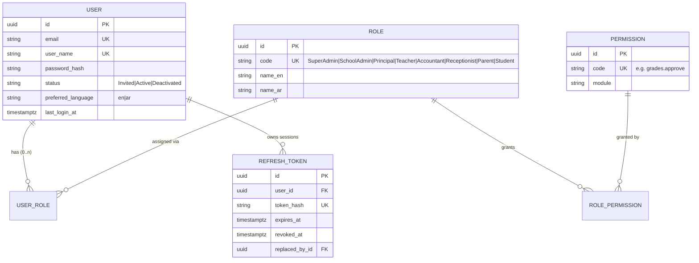
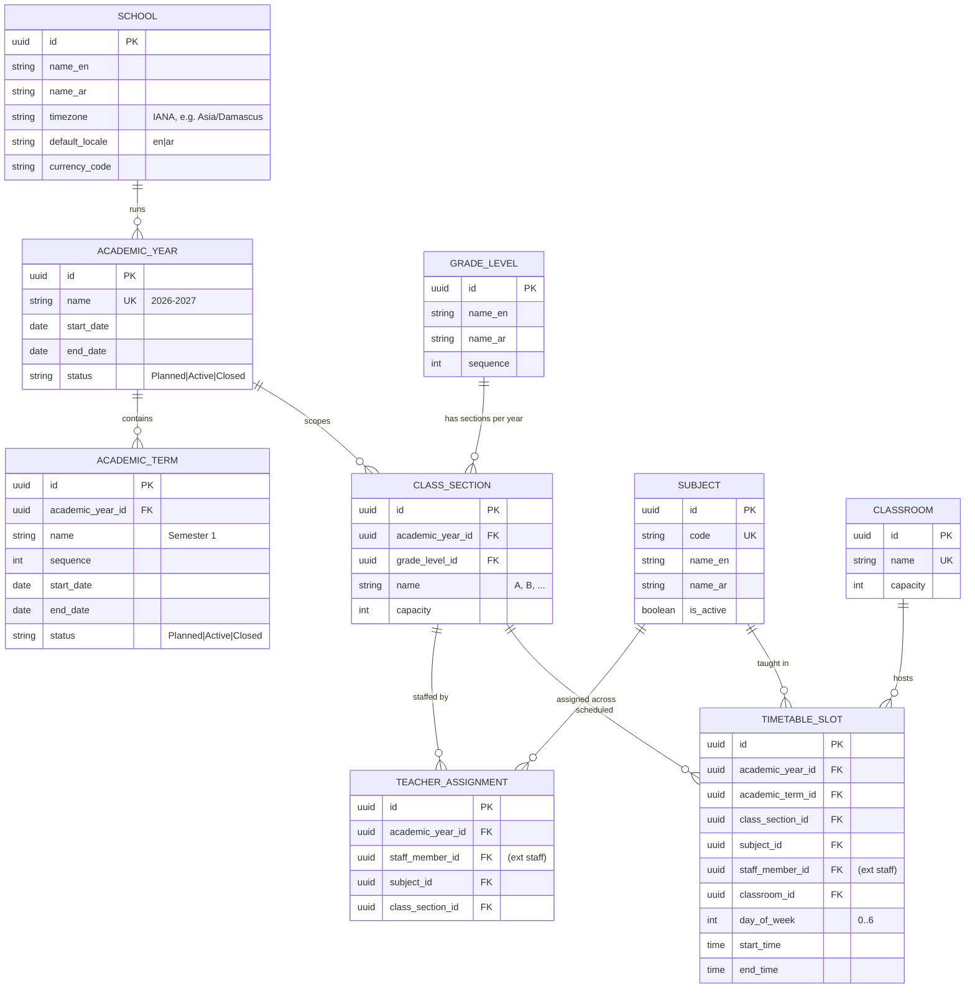
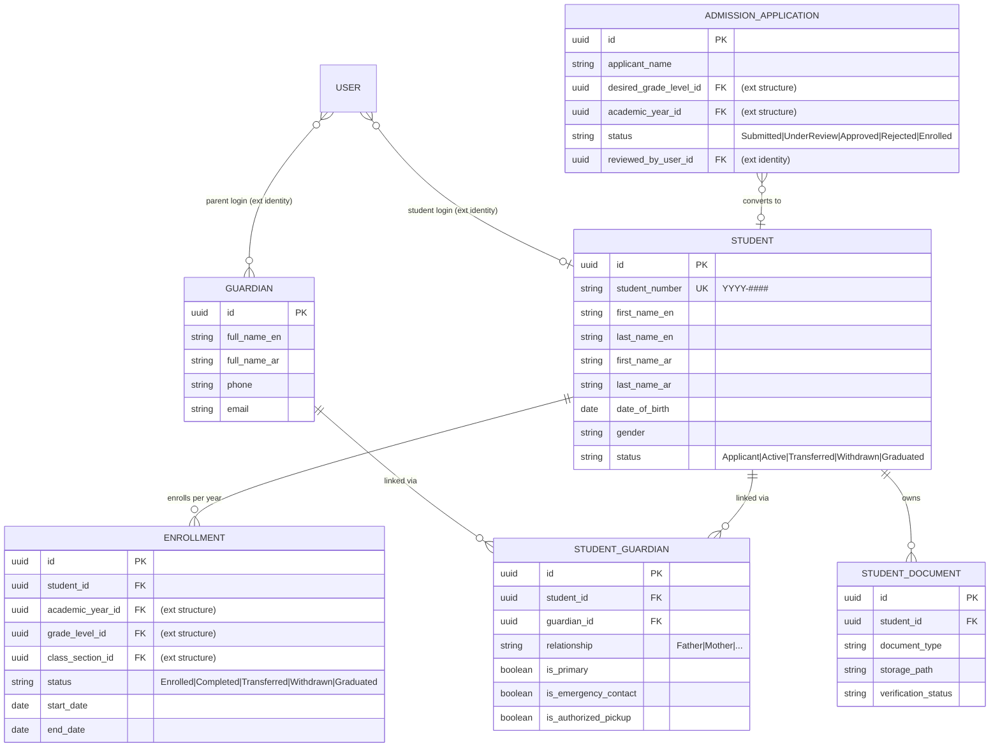
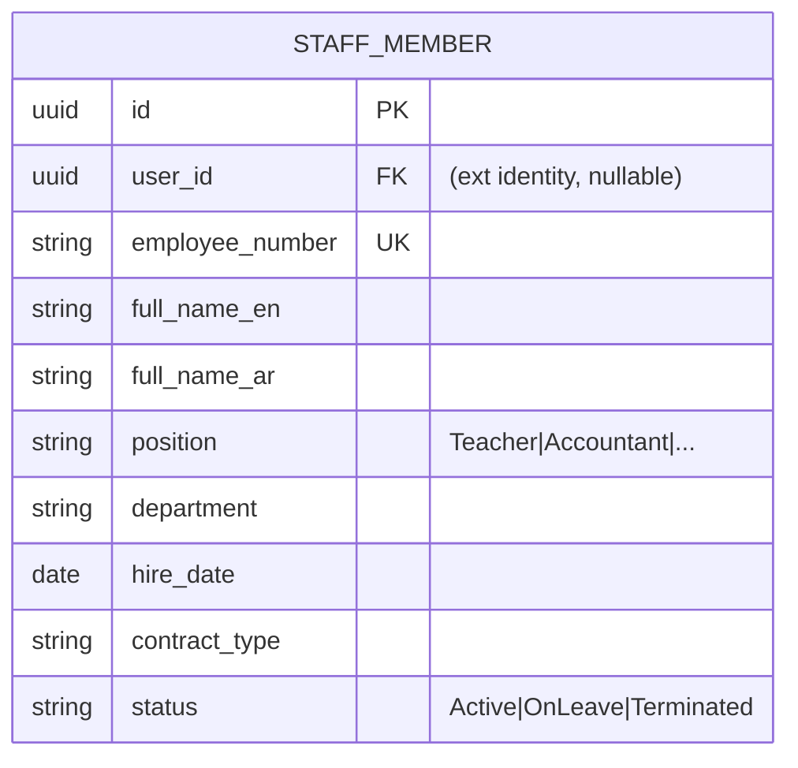
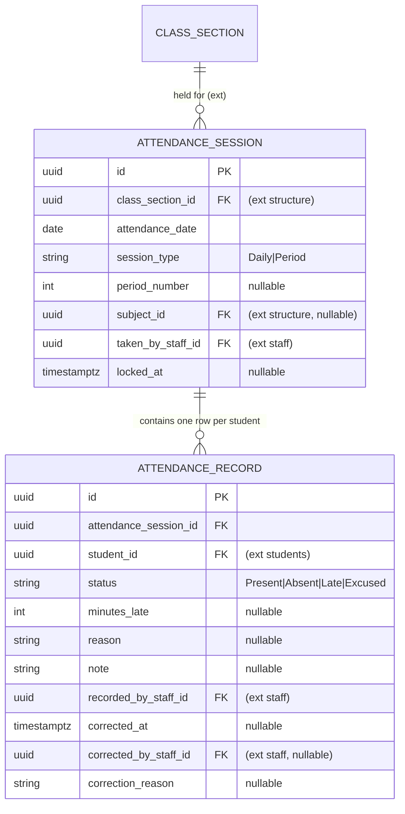
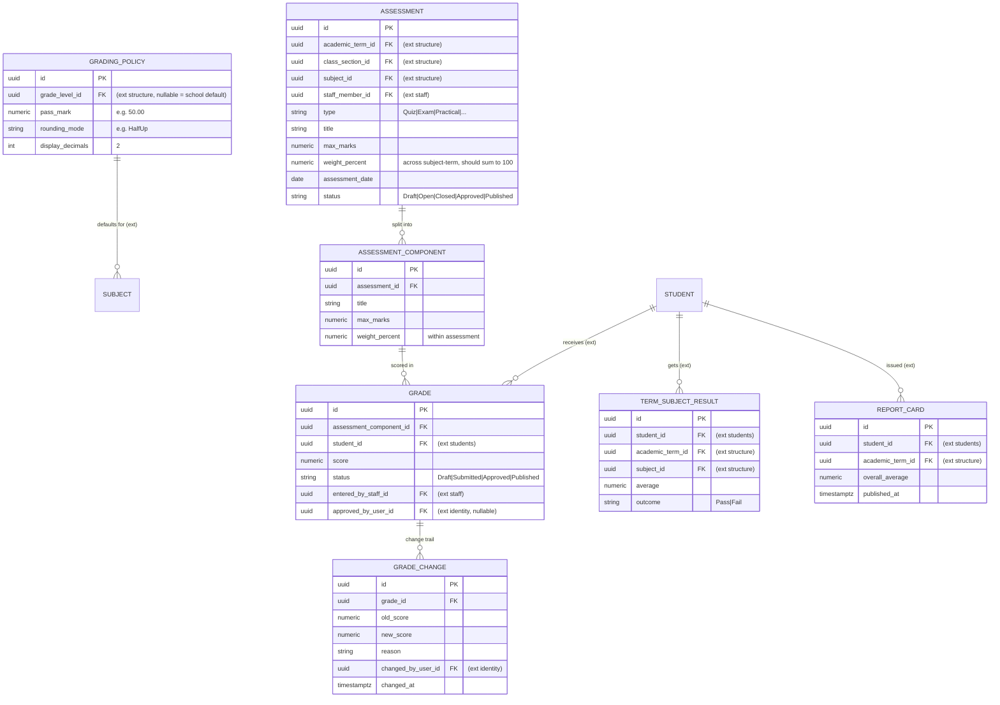
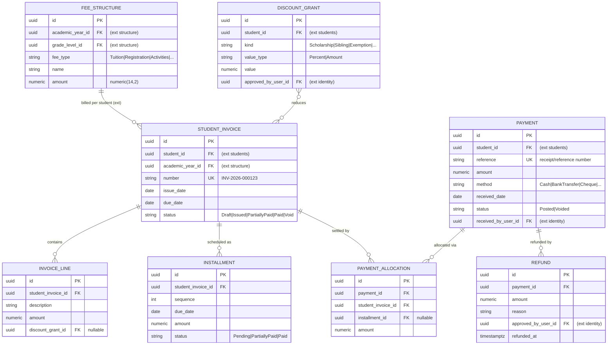
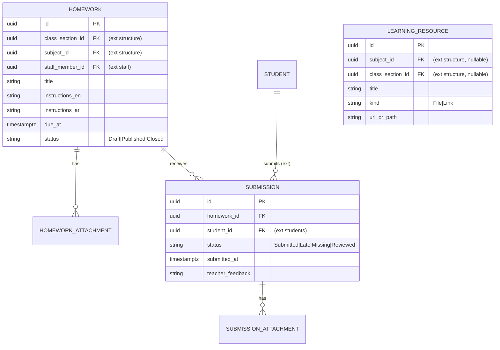
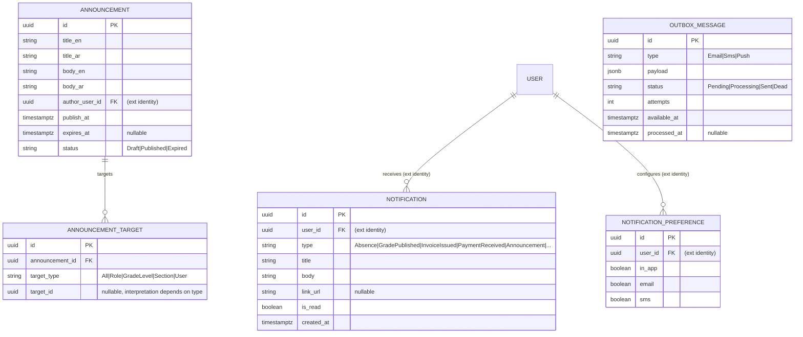
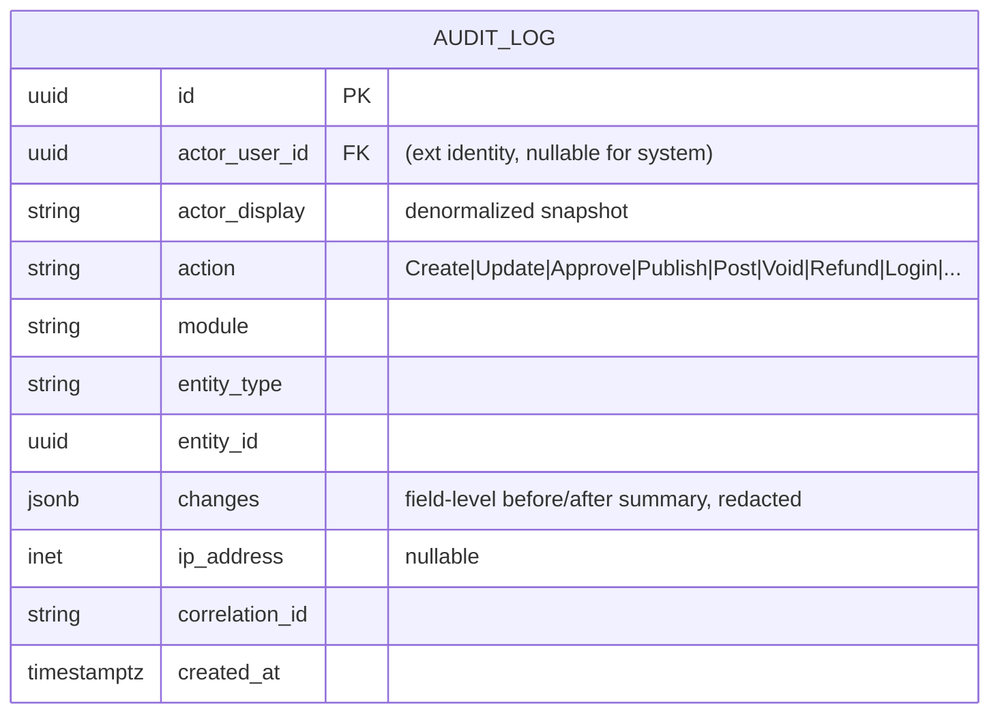

# SchoolOS — Entity Relationship Design (ERD)

> **Status:** Phase 1 deliverable (draft v1, 2026-10-12).
> **Companion docs:** `requirements.md`, `architecture.md`, `database-design.md` (full column/type/constraint details), `security-plan.md`, `implementation-plan.md`.
>
> Conventions: entity names singular PascalCase (tables snake_case in `database-design.md`); primary keys are UUIDv7 unless noted; instants are UTC (`timestamptz`), calendar dates are plain `date` in school-local terms. Diagrams are split per module (PostgreSQL schema) — cross-module references are by ID and shown as `(ext)`.

---

## 1. Identity & Access — schema `identity`

- `User` is the single account record for every persona; role codes are fixed (the 8 brief roles), permissions form a catalog seeded in DB and are grouped into roles.
- `Student` and `Guardian` logins link back to their `User` row (see §3); `StaffMember` optionally links to a `User` (staff with portal accounts).
- `RefreshToken` rows are hashed; reuse detection revokes the token family.

## 2. School & Structure — schema `structure`

Key rules:

- **Class sections belong to an academic year** — sections are re-created (or cloned) per year, so timetable, attendance, and enrollments never leak across years.
- `TeacherAssignment` is unique per (staff, subject, section, year).
- `TimetableSlot` conflicts (same teacher / same classroom / same section overlapping in time) are rejected — enforced with PostgreSQL exclusion constraints (see `database-design.md` §8) plus application checks.
- `School` is a singleton settings row per deployment (Q6: single school).

## 3. Students — schema `students`

Key rules:

- **Enrollment history is preserved**: transfers/withdrawals/graduation close the open row (`end_date`, outcome status) — never overwritten; year progression opens a new row; a same-year section change updates the open row and is fully audited (see `database-design.md` §4). Unique constraint: at most one open (`Enrolled`) row per student+year.
- `StudentGuardian` is many-to-many with flags; every portal request re-verifies an active link (parent-child enforcement, see `security-plan.md`).
- Student numbers are immutable once assigned (Q7 format).

## 4. Staff — schema `staff`

- Workload and teaching schedule are **derived** from `TeacherAssignment` and `TimetableSlot` — not duplicated here.
- Staff attendance (optional per config, Q4) reuses the attendance module with a staff-specific session type (documented in `database-design.md`).

## 5. Attendance — schema `attendance`

Key rules:

- **Duplicate prevention:** unique (attendance_session_id, student_id) at the database level.
- Corrections mutate status/fields but always record `corrected_at/by/reason`; the full before/after trail lives in `AuditLog`.
- Recurring-absence detection is a scheduled job that reads these records and emits notifications.

## 6. Academics — schema `academics`

Key rules:

- Weights: component weights within an assessment and assessment weights within a subject-term are validated to sum to 100 (±0.01) before approval; max marks are validated consistently.
- Grade lifecycle: teacher draft → submit → principal/admin approval → publication. After publication, edits only via the audited correction flow that writes `GradeChange` (old, new, reason, actor, timestamp).
- `TermSubjectResult` and `ReportCard` are **materialized snapshots created at publication** — issued documents are immutable; later corrections create revised versions, never silent rewrites.

## 7. Finance — schema `finance`

Key rules and invariants:

- Money is `numeric(14,2)` end-to-end; all write operations are transactional.
- **Posted payments are immutable** — voiding/reversal creates new records, never edits; refunds reference the original payment and require approval.
- Allocations per payment never exceed the payment amount; invoice balance = lines − discounts − allocations; validation is both application-side and DB-checked where possible.
- Overpayments land on a student credit balance (Q3 default) — modeled as an unallocated payment remainder, not negative invoice lines.

## 8. Learning — schema `learning`

Key rules: unique (homework_id, student_id); submissions accepted after due date are marked `Late`; teacher feedback stored on the submission.

## 9. Communication — schema `communication`

Key rules: notifications are written in-app immediately (same transaction as the trigger) while external sends flow through the outbox; read/unread is per notification; preferences gate external channels only.

## 10. Audit — schema `audit`

Key rules: append-only; **never contains passwords, tokens, or secrets**; denormalized actor display so logs survive account deactivation; retained per policy (documented in `security-plan.md`).

## 11. Global relationship summary

| Entity | Relates to | Cardinality | Rule |
|---|---|---|---|
| User — Role | via UserRole | n..n | Role codes fixed; user has ≥1 role. |
| Role — Permission | via RolePermission | n..n | Permissions are capability codes. |
| AcademicYear — AcademicTerm | contains | 1..n | One active year; terms ordered. |
| GradeLevel — ClassSection | per year | 1..n | Sections scoped to academic year. |
| StaffMember — TeacherAssignment | assigned | 1..n | Unique per (staff, subject, section, year). |
| ClassSection — TimetableSlot | scheduled | 1..n | No overlapping slots per teacher/room/section. |
| Student — Guardian | via StudentGuardian | n..n | Flags: primary, emergency, pickup. |
| Student — Enrollment | history | 1..n | Append-only; one active per year. |
| AttendanceSession — AttendanceRecord | records | 1..n | Unique (session, student). |
| Assessment — AssessmentComponent | split | 1..n | Weights validated. |
| Grade — GradeChange | trail | 1..n | Append-only; reason required. |
| StudentInvoice — Installment | schedule | 1..n | Sum matches invoice net of discounts. |
| Payment — PaymentAllocation | allocates | 1..n | Σ allocations ≤ payment amount. |
| Refund — Payment | against | n..1 | Requires approval; audited. |
| Homework — Submission | receives | 1..n | Unique (homework, student). |
| User — Notification | receives | 1..n | Read/unread state. |
| (any) — AuditLog | audited as | 1..n | Append-only, redacted. |

## 12. Key design decisions (rationale)

1. **Sections are year-scoped** (`ClassSection.academic_year_id`): avoids the classic bug where timetable/attendance/enrollment for different years collide; cloning a year is an explicit operation.
2. **Enrollment as append-only history**: status transitions close rows, never overwrite; transfers keep a full chain (previous → new).
3. **Publication snapshots** (`TermSubjectResult`, `ReportCard`): issued report cards must not change when a late grade correction happens; corrections produce revised published versions.
4. **Grades at component granularity**: `Grade` references `AssessmentComponent`; simple assessments can have a single implicit component — this keeps the model uniform without special cases.
5. **Ledger-style finance**: payments/refunds/allocations are events; balances are derived; no destructive edits. This gives auditability and reconciliation for free.
6. **DB-level duplicate prevention** (attendance, enrollment, submissions, payment references) — application validation alone is insufficient under concurrency.
7. **Audit as a separate append-only stream**, written by interceptor + explicit events, not by trigger hacks; content rules prevent secret leakage.
8. **Refinements vs. the brief's candidate list**: added `Installment`, `DiscountGrant`, `TermSubjectResult`, `ReportCard`, `AnnouncementTarget`, `NotificationPreference`, `OutboxMessage`, `RefreshToken`, `AdmissionApplication`, `StudentDocument` because the required workflows need them; `School` kept as a singleton settings entity. No candidate entity was dropped without replacement.
